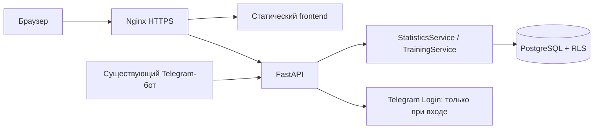

# Веб-сервис статистики Climbing Journal

Дата: 22.10.2026. Статус: первый frontend реализован в `web/`, приложение не развёрнуто.
Работают экраны и демонстрационный режим. Подключение личных данных требует
серверной веб-сессии; ограничения и запуск описаны в `web/README.md`.
Согласованный формат: отдельный адаптивный сайт. Расчётный масштаб:
10 000 зарегистрированных пользователей, 1 000 активных в день.

## 1. Продукт и первая версия

Личный кабинет показывает статистику и историю того же пользователя, который
ведёт журнал в Telegram. Вход через Telegram, существующие аккаунты и одобрения
владельцем сохраняются. Повторный импорт тренировок и отдельная база не нужны.

Первая версия предназначена для просмотра. Запись и редактирование остаются
в боте; из карточки тренировки можно открыть бота. Веб-редактор, публичные
профили, рейтинги, платежи и Mini App — отдельные последующие задачи.

### Экраны

| Экран | Содержимое и действия |
|---|---|
| Вход | «Войти через Telegram», состояние ошибки или отсутствия доступа |
| Обзор | Период, сводка, три максимума, график активности, категории, последняя тренировка |
| Прогресс | Динамика попыток, чистых пролазов и максимальной категории по периодам |
| Тренировки | Дата, район, секторы, трассы, попытки, чисто; пагинация и открытие сводки |
| Тренировка | Сводка, реальные места пролазов, трассы и все попытки с характеристиками |
| Профиль | Имя, часовой пояс, выход и выход со всех устройств |

Вторая очередь: отдельные страницы проектов, рекордов и подробного анализа
локаций. Эти данные можно добавить после выпуска основного обзора и истории.

### Схема обзора

```text
Climbing Journal                       Тренировки  Прогресс  Профиль

Обзор        [Неделя] [Месяц] [Год] [Свой период]       [Фильтры]
Период: 01–22.10.2026 · Europe/Moscow

[Тренировки] [Выходы на трассы] [Попытки] [Дошёл] [Чисто]

Максимум: пробовал …  |  дошёл …  |  чисто …

[Активность и чистые пролазы по дням]    [Распределение по категориям]

Категория | Выходы на трассы | Попытки | Чисто | Доля чистых
...

Последние тренировки: дата · район · секторы · результат → Подробнее
```

Все цифры в макете — поля для реальных данных, не демонстрационная статистика.
На телефоне карточки переносятся в две колонки, графики — в одну;
таблицы прокручиваются горизонтально. У графиков есть подписи и табличный вид,
результаты различаются текстом/значком, а не только цветом.

## 2. Правила данных

- Единственный источник расчётов — существующий `StatisticsService` в FastAPI.
  Веб-клиент форматирует DTO; суммы, проценты и правила чистоты не дублируются в JS.
- Статистика всегда исключает `is_test`; переключатель тестового режима бота
  не включает тестовые попытки в веб-агрегаты. Диагностический просмотр тестовых
  записей в истории — позже, отдельно от статистики.
- Пустая или полностью тестовая тренировка не увеличивает число тренировок
  периода. В истории пустую тренировку можно показать с явным состоянием.
- `reached_top` и `clean_ascent` независимы; срыв/зависание исключает чистоту.
  Стиль и страховка показаны отдельными полями, включая «Верхняя» в обеих шкалах.
- Текущая сводка считает выходы на трассу по `route_session_key`, а попытки —
  по сумме `attempts`. Это не количество уникальных каталожных `route_id`.
  В интерфейсе назвать показатель «Выходы на трассы» и дать подсказку.
  Число уникальных маршрутов, если добавляется, считается отдельно.
- Три максимума: пробовал / дошёл до конца / чисто. Сортировка категорий
  серверная: `6B < 6B/6B+ < 6B+ < 6C`; латиница/кириллица нормализуются.
- Историческая категория берётся из snapshot. Явно неизвестная категория
  не заменяется текущей категорией каталога. Неизвестное значение — «—».
- Неизвестная длительность не означает ноль: показывать известную сумму и
  число тренировок без длительности. Этот признак нужно добавить в DTO.
- Место тренировки и место конкретного пролаза могут различаться. Фильтр
  района/сектора статистики работает по snapshot попытки, а не только по
  `training.primary_location_id`. Карточка показывает оба контекста.
- Дата периода — `local_date`, границы включительны. Время показывается
  в часовом поясе пользователя. Дни без тренировок внутри периода — нули
  активности, а не пропущенные точки.

Стили Onsight/Flash/Red Point в сводке сейчас считаются по первому чистому
пролазу группы; страховки и стили «Со срывом»/«С зависанием» — по попыткам.
Для них нужны разные графики с указанной единицей измерения, общий круговой
график всех этих значений недопустим.

## 3. Периоды и фильтры

Первая версия: период и точная категория. Следующий этап: район, сектор,
страховка, стиль и конкретная каталожная трасса — после общей поддержки
фильтров в backend. Не показывать фильтр, который сервер ещё не применяет.

Фильтры объединяются через «и», сохраняются в query-параметрах URL, одинаково
применяются к карточкам, графикам, таблицам и переходу в список попыток.
При смене фильтра сбрасывается курсор истории. Все виджеты используют один
нормализованный сервером набор фильтров.

Сравнение: выбранный период с непосредственно предшествующим интервалом такой
же длины; для месяца до текущей даты — с такой же частью предыдущего месяца,
ограниченной его последним днём. Обе даты показываются явно.
Это новое правило для веб-обзора: нынешний Telegram `month` сравнивает неполный
месяц с полным предыдущим. Старое поведение не менять незаметно: новый контракт
принимает явные границы сравнения, расчёт выполняется тем же сервисом.

## 4. Архитектура и технологии

Предлагаемый UI: React + TypeScript + Vite, графики Recharts. Этот выбор отделяет
визуальную часть от Python-бизнес-логики и позволяет собрать статические файлы.
SSR для закрытой статистики в первой версии не требуется.



Один origin: `/` — сайт, `/api/` — FastAPI; `/telegram/webhook` сохраняется.
Существующие запреты `/api/v1/internal/` и `/api/v1/tools/` остаются.
Сборка frontend отдельным Docker build-stage, результат включается в образ
существующего nginx. Дополнительный Node-процесс, Supabase или Redis в MVP
не нужны. Корневой `package.json` принадлежит OpenClaw-плагину: web размещается
в отдельной директории `web/` со своим lock-файлом и командами сборки.

Официальные материалы: [React](https://react.dev/learn/build-a-react-app-from-scratch),
[Vite production build](https://vite.dev/guide/build),
[Recharts](https://recharts.github.io/en-US/guide/).

## 5. Вход и доступ

Использовать Telegram Login через серверный OpenID Connect Authorization Code
flow с PKCE. Зарегистрировать разрешённые URL и callback в BotFather.
Запрашивать `openid profile`, без телефона. Backend проверяет подпись ID token,
issuer, audience и срок действия; `state` привязан к браузеру и одноразовому
входу. Client Secret остаётся на сервере.

Существующая привязка `external_refs(system=telegram)` использует Telegram user
ID из проверенного profile-claim `id`. OIDC `sub` — отдельный идентификатор:
нельзя подставлять его вместо Telegram ID. Конфликт привязок отклоняется.
Проверки реализовать готовой OIDC-библиотекой; отдельный UserInfo-запрос не нужен.
Источник: [официальный Telegram Login](https://core.telegram.org/bots/telegram-login).

Веб-сессия создаётся только для уже активного аккаунта. Неизвестному пользователю
и ожидающему одобрения показывается переход в существующего бота для заявки.
Заблокированный пользователь не получает данных. Вход не выдаёт одобрение.

Сессии остаются в существующей PostgreSQL-таблице `auth_sessions`: добавить
признак канала и поддержку веб-сессии. Бот сохраняет текущий срок 15 минут;
для сайта предлагается абсолютный срок 24 часа без refresh-токена в JS.
Общий выход и блокировка действуют на оба канала.

Браузеру выдаётся непрозрачная cookie `__Host-climbing_session` с `HttpOnly`,
`Secure`, `SameSite=Lax`, `Path=/`. Токен не хранится в localStorage и URL.
Cookie-вход добавляется к текущей проверке Bearer; конфликт разных credentials
отклоняется. Сервер определяет пользователя, `user_id` от клиента не принимается.
Все изменяющие cookie-запросы, включая выход, защищаются проверкой Origin и CSRF.

Нужно разрешить API выход к OIDC/JWKS endpoint Telegram: сейчас контейнер API
находится только во внутренней сети Compose. Таймауты, кэш публичных ключей и
ошибки провайдера обрабатываются в auth-модуле. Вход не требует LLM.

## 6. Существующий API и необходимые изменения

Проверено по текущему коду, а не по прежним планам.

| Уже есть | Использование / ограничение |
|---|---|
| `GET /api/v1/me` | Профиль и часовой пояс |
| `/statistics/week`, `/month`, `/grades`, `/progress` | Базовые агрегаты; общий фильтр периода/категории уже доступен |
| `/statistics/locations`, `/projects`, `/records` | Основы следующих экранов; проекты ограничены выдачей и группируются по сессии трассы |
| `/statistics/current-training`, `/statistics/trainings/last` | Текущая/последняя сводка |
| `GET /trainings`, `GET /trainings/{id}` | История и попытки, но список загружает попытки целиком, нет готовой сводки район+секторы |
| `/catalog-search/{kind}` | Поиск по всем доступным названиям/транслитерации, необязательный родитель |
| `/api/v1/internal/auth/telegram` | Только доверенный сервис; браузеру недоступен, открывать его нельзя |
| `POST /api/v1/auth/logout`, `/logout-all` | Ревокация; для web дополнить cookie/CSRF и очисткой cookie |

Пути статистики и тренировок в таблице имеют общий префикс `/api/v1`.
Текущий `StatisticsDTO` допускает динамические поля через `extra=allow`:
для генерации клиентских типов нужно явно описать все выдаваемые структуры.

### Предлагаемый контракт

| Новый / расширяемый endpoint | Назначение |
|---|---|
| `GET /api/v1/auth/telegram/start` | Одноразовый OIDC flow и redirect |
| `GET /api/v1/auth/telegram/callback` | Проверка входа, выдача cookie, redirect на сайт |
| `GET /api/v1/auth/session` | Состояние веб-входа и контракт CSRF |
| `GET /api/v1/statistics/dashboard` | Единый типизированный DTO обзора с summary, grades, стилями, страховками и comparison |
| `GET /api/v1/statistics/series` | График по дням/неделям/месяцам за указанный период |
| `GET /api/v1/trainings/history` | Лёгкие сводки с районами и секторами, фильтрами и cursor без вложенных попыток |
| `GET /api/v1/trainings/{id}` | Дополнить сводкой, именами мест и версией; сохранить нынешние поля для совместимости |

Статические `/statistics/dashboard`, `/statistics/series` зарегистрировать
**до** `/statistics/{scope}`, `/trainings/history` — до `/trainings/{id}`.
Иначе динамические маршруты перехватят запросы.

Общий объект фильтров: `date_from`, `date_to`, `grade`, далее `location_id`,
`section_id`, `route_id`, `style`, `belay`. Для series добавить `bucket`;
для dashboard — явные `compare_from`, `compare_to`. Курсоры истории привязываются
к пользователю и фильтрам; сортировка: `local_date, created_at, id` по убыванию.
Старые endpoints бота сохраняют совместимость.

Новые endpoints — адаптеры к тому же `StatisticsService`, а не отдельные формулы.
Series возвращает серверные категории и их ранг; frontend не сортирует строки
категорий самостоятельно. В новом DTO для нулевых знаменателей ratio — `null`,
в UI «—». Это явно описанное преобразование контракта: старые поля, где backend
возвращает 0 для пустой выборки, сохраняют совместимость.

## 7. Изменения БД, производительность и эксплуатация

Таблицы журнала не дублируются. Нужны миграции для канала веб-сессии и временных
OIDC flows: срок жизни, хэш state, привязка к браузеру и данные PKCE; таблица
доступна только auth/control-слою, не пользовательской DB-роли. Flow живёт
до 5 минут и потребляется один раз. Просроченные flows чистит существующее
обслуживание; секреты входа и токены не попадают в логи.

Цель для проверки под нагрузкой: p95 API статистики до 500 мс на согласованном
наборе данных. Это целевой критерий, не обещание для нынешнего сервера.
История — по 20 тренировок; детализация загружается отдельно. Для series
ограничить количество точек (например, до 366 дневных); длинный период требует
недельной/месячной группировки с понятной ошибкой при превышении лимита.

Профилировать запросы на репрезентативной истории, использовать существующие
индексы по пользователю, дате и связям; новые индексы добавлять по планам запросов.
Текущий Python-расчёт читает строки выбранного периода: для длинной истории
нужно ограничение/SQL-агрегация внутри общего сервиса, без расхождения с ботом.

Начать без серверного кэша агрегатов. Кэш клиента хранится в памяти и привязан
к пользователю и фильтрам, полностью очищается при выходе. Не кэшировать личные
API-ответы в nginx, shared cache или Service Worker. Статика с хэшем кешируется;
`index.html` обновляется вместе с релизом, API — `Cache-Control: no-store`.

Активную страницу можно обновлять раз в 30 секунд; на скрытой вкладке остановить
polling. Новый пролаз появляется после коммита обработки бота, незавершённая
AI-задача не считается сохранённой записью. Для 401 очистить UI и предложить вход,
403 — показать отсутствие доступа; 429 — ограниченный повтор с задержкой.

Развёртывание: существующий Docker Compose, домен с HTTPS, регистрация callback,
миграции, сборка web, обновление nginx/API. Откат образов готовится заранее;
миграции auth делать совместимыми с предыдущим backend. Нужен отдельный
проверочный Telegram-аккаунт, чтобы не создавать тестовые записи в личной истории.

## 8. Этапы и критерии приёмки

1. Зафиксировать DTO, расчёт сравнений и фильтры; сделать лёгкую историю и series.
2. Реализовать OIDC, cookie-сессии, статусы доступа и тесты изоляции.
3. Выпустить обзор, категории, график и историю с детализацией на desktop/mobile.
4. Проверить реальные данные, нагрузку, пустые/тестовые состояния и развернуть.
5. Добавить расширенные фильтры, локации, проекты и рекорды. Для проектов отдельно
   согласовать сущность проекта между тренировками: нынешняя группа — сессия трассы.

Приёмка первой версии:

- Два пользователя видят только свои записи; чужой `training_id` не раскрывает данные.
- OIDC-подмена/просроченный callback, повтор flow, блокировка, выход со всех устройств
  и POST без CSRF проверяются; внутренний ключ API никогда не передаётся в web.
- Обзор и бот дают одинаковые показатели для одинаковой выборки; различие политики
  сравнения периодов отображено явно и не меняет базовые счётчики.
- Полностью тестовые тренировки и попытки исключены из агрегатов; неизвестные
  категории/чистота и пустой период не превращаются в ложные достижения.
- История показывает район и секторы, детали — корректные места отдельных попыток;
  смена даты тренировки в боте переносит её в правильный период сайта.
- Канонизация личных трасс не теряет попытки и исторические категории.
- Страница работает при 360 px и с клавиатуры; состояние загрузки, ошибка,
  отсутствие данных и истёкшая сессия различаются.
- Рабочие записи для проверки не создаются; достаточно нескольких проверок
  авторизации, паритета расчётов и одного сквозного сценария вход → обзор → тренировка.

До реализации требуется выбрать домен; оформление и название можно начать
с существующего Climbing Journal. Разработка кода и публикация сайта в эту
задачу проектирования не входят.
